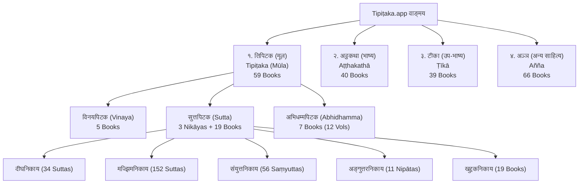
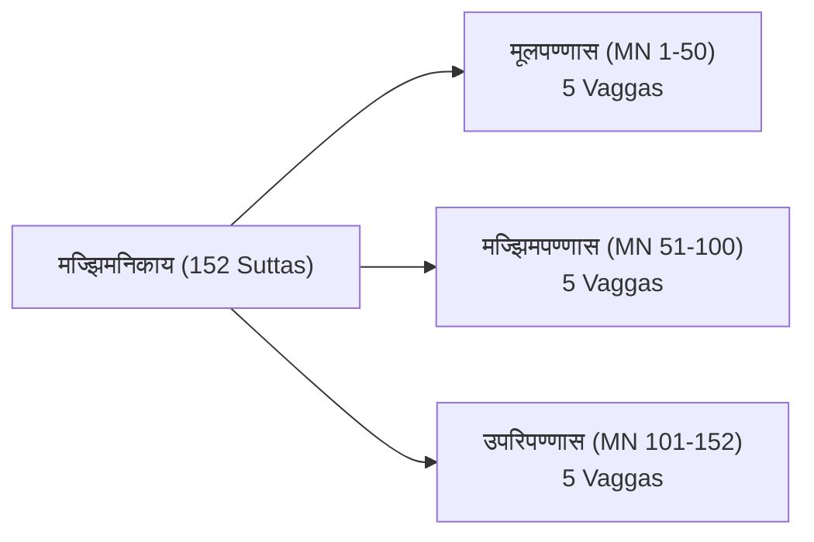
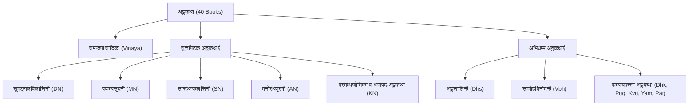
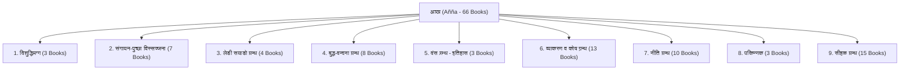

# Tipiṭaka Outline – Chaṭṭha Saṅgāyana Edition
### तिपिटक सम्पूर्ण रूपरेखा (Tipiṭaka.app संरचना एवं डेटा-मॉडल पर आधारित)

> **परिचय (Introduction):**  
> यह रूपरेखा बर्मा (म्यांमार) में आयोजित **छट्ठ संगायन (Sixth Buddhist Council, 1954–1956)** के प्रामाणिक संस्करण पर आधारित है, जिसे **विपश्यना विशोधन विन्यास (VRI / tipitaka.org)** और **Tipiṭaka.app** द्वारा डिजिटल रूप में संरक्षित एवं प्रस्तुत किया गया है।  
> `tipitaka.app` में सम्पूर्ण पाळि वाङ्मय को **४ मुख्य संकलनों (4 Collections)**, **३९ समूहों (39 Groups)** और **२०४ ग्रन्थों (204 Books)** में व्यवस्थित किया गया है।

---

## 🏛️ मुख्य संकलन (The 4 Major Collections)

| संकलन (Collection) | Pāḷi नाम | Key Prefix | विवरण | ग्रन्थ संख्या |
| :--- | :--- | :--- | :--- | :--- |
| **१. Mūla** | तिपिटक (मूल) | *(कोई उपसर्ग नहीं)* | बुद्ध वचन (कैननिकल मूल त्रिपिटक ग्रन्थ) | **५९** |
| **२. Aṭṭhakathā** | अट्ठकथा | `atta-` | प्राचीन आचार्यों (बुद्धघोष आदि) द्वारा रचित प्रामाणिक भाष्य | **४०** |
| **३. Ṭīkā** | टीका | `tika-` | अट्ठकथाओं की व्याख्या व दार्शनिक मीमांसा (उप-भाष्य) | **३९** |
| **४. Añña** | अञ्ञ | `anya-` | विशुद्धिमग्ग, इतिहास (वंस), व्याकरण, नीति व वन्दना साहित्य | **६६** |
| **कुल (Total)** | | | | **२०४ ग्रन्थ** |

---

## 🔑 Tipiṭaka.app URL एवं Key संरचना (URL & Key Contract)

`tipitaka.app` में हर ग्रन्थ, अध्याय और सुत्त का एक निश्चित, अपरिवर्तनीय **Key** होता है जो URL में प्रयुक्त होता है:
- **मूल सुत्त:** `/<script>/<key>` (जैसे: `https://tipitaka.app/deva/kn-dhp-1` या `https://tipitaka-app-7o5.pages.dev/#/deva/dn-1-1`)
- **अट्ठकथा:** `atta-` उपसर्ग के साथ (जैसे: `atta-kn-dhp` या `atta-dn-1-1`)
- **टीका:** `tika-` उपसर्ग के साथ (जैसे: `tika-dn-1-1`)
- **अनुवाद व परिच्छेद:** पैराग्राफ एंकर `#p<idx>` (जैसे `#p4` = गाथा १)

---

# खण्ड १: तिपिटक (मूल) – Tipiṭaka (Mūla)

---

## १. विनयपिटक (Vinayapiṭaka)
भिक्षु एवं भिक्षुणी संघ के आचार-नियम, अनुशासन, प्रतिमोक्ष एवं संघ-कर्मों का विधान।

| क्र. | ग्रन्थ का नाम (Pāḷi) | Devanagari | Key | भाग / विवरण |
| :---: | :--- | :--- | :--- | :--- |
| **१** | **Pārājikapāḷi** | पाराजिकपाळि | `vp-prj` | महाविभङ्ग १: पाराजिक ४, सङ्घादिसेस १३, अनियत २, निस्सग्गिय पाचित्तिय ३० |
| **२** | **Pācittiyapāḷi** | पाचित्तियपाळि | `vp-pct` | महाविभङ्ग २ (पाचित्तिय ९२, पाटिदेसनीय ४, सेखिय ७५) + भिक्खुनीविभङ्ग |
| **३** | **Mahāvaggapāḷi** | महावग्गपाळि | `vp-mv` | खन्धक १: महाखन्धक (प्रव्रज्या-उपसम्पदा), उपोसथ, वस्सूपनायिका, पवारणा, चम्म आदि |
| **४** | **Cūḷavaggapāḷi** | चूळवग्गपाळि | `vp-cv` | खन्धक २: कम्मखन्धक, परिवासिक, समुच्चय, समथ, सेनासन, प्रथम व द्वितीय संगीति |
| **५** | **Parivārapāḷi** | परिवारपाळि | `vp-pv` | विनय के नियमों का सार-संक्षेप, प्रश्नोत्तरी, अध्ययन मार्गदर्शिका |

---

## २. सुत्तपिटक (Suttapiṭaka)
तथागत बुद्ध और उनके प्रमुख श्रावकों के धर्मोपदेशों का विशाल संग्रह, जो ५ निकायों में विभक्त है:

### (क) दीघनिकाय (Dīghanikāya) – ३४ दीर्घ सुत्त
दीर्घ उपदेशों का संग्रह, ३ वर्गों में विभक्त:

#### १. सीलक्खन्धवग्गपाळि (Sīlakkhandhavaggapāḷi – `dn-1`)
*नैतिक आचार (चूळसील, मज्झिमसील, महासील) एवं ६२ मिथ्या दृष्टियों की विस्तृत विवेचना।*
1. **ब्रह्मजालसुत्तं (Brahmajālasuttaṃ – `dn-1-1`):** ६२ कुदृष्टियों का जाल एवं सर्वज्ञ प्रज्ञा
2. **सामञ्ञफलसुत्तं (Sāmaññaphalasuttaṃ – `dn-1-2`):** अजातशत्रु को श्रमणत्व के प्रत्यक्ष लाभ
3. **अम्बट्ठसुत्तं (Ambaṭṭhasuttaṃ – `dn-1-3`):** वर्ण-व्यवस्था का खण्डन, विद्या-चरण सम्पदा
4. **सोणदण्डसुत्तं (Soṇadaṇḍasuttaṃ – `dn-1-4`):** सच्चा ब्राह्मण कौन?
5. **कूटदन्तसुत्तं (Kūṭadantasuttaṃ – `dn-1-5`):** अहिंसक यज्ञ की श्रेष्ठता
6. **महालिparamसुत्तं (Mahālisuttaṃ – `dn-1-6`):** दिव्य चक्षु एवं ब्रह्मचर्य का उद्देश्य
7. **जालियसुत्तं (Jāliyasuttaṃ – `dn-1-7`):** क्या जीव और शरीर एक हैं?
8. **महासीहनादसुत्तं (Mahāsīhanādasuttaṃ – `dn-1-8`):** काश्यप अचेलक संवाद (कठिन तपस्या बनाम आर्य आष्टाङ्गिक मार्ग)
9. **पोट्ठपादसुत्तं (Poṭṭhapādasuttaṃ – `dn-1-9`):** संज्ञा निरोध एवं आत्मा का भ्रम
10. **सुभसुत्तं (Subhasuttaṃ – `dn-1-10`):** आनन्द द्वारा सुभ को बुद्ध के शील-समाधि-प्रज्ञा का उपदेश
11. **केवट्टसुत्तं (Kevaṭṭasuttaṃ – `dn-1-11`):** ऋद्धि चमत्कार बनाम अनुशासन चमत्कार
12. **लोहिच्चसुत्तं (Lohiccasuttaṃ – `dn-1-12`):** श्रेष्ठ गुरु के लक्षण
13. **तेविज्जसुत्तं (Tevijjasuttaṃ – `dn-1-13`):** त्रिवेद बनाम ब्रह्म-सहव्यता (चार ब्रह्मविहार)

#### २. महावग्गपाळि (Mahāvaggapāḷi – `dn-2`)
*गम्भीर दार्शनिक एवं ऐतिहासिक दृष्टि से सर्वाधिक महत्वपूर्ण सुत्त।*
14. **महापदानसुत्तं (Mahāpadānasuttaṃ – `dn-2-1`):** विपस्सी बुद्ध एवं अतीत के ६ बुद्धों का जीवन
15. **महानिदानसुत्तं (Mahānidānasuttaṃ – `dn-2-2`):** प्रतीत्यसमुत्पाद (पटिच्चसमुप्पाद) का गम्भीरतम विश्लेषण
16. **महापरिनिब्बानसुत्तं (Mahāparinibbānasuttaṃ – `dn-2-3`):** तथागत के अन्तिम दिन, परिनिर्वाण एवं धातु-विभाजन
17. **महासुदस्सनसुत्तं (Mahāsudassanasuttaṃ – `dn-2-4`):** चक्रवर्ती राजा महासुदर्शन की कथा
18. **जनवसभसुत्तं (Janavasabhasuttaṃ – `dn-2-5`):** बिम्बिसार राजा की जनवसभ देव रूप में उत्पत्ति
19. **महागोविन्दसुत्तं (Mahāgovindasuttaṃ – `dn-2-6`):** महागोविन्द बोधिसत्व की कथा
20. **महासमयसुत्तं (Mahāsamayasuttaṃ – `dn-2-7`):** कपिलवस्तु में देवताओं का महासम्मेलन
21. **सक्कपञ्हसुत्तं (Sakkapañhasuttaṃ – `dn-2-8`):** इन्द्र (शक्र) के प्रश्नों का बुद्ध द्वारा समाधान
22. **महासतिपट्ठानसुत्तं (Mahāsatipaṭṭhānasuttaṃ – `dn-2-9`):** विपश्यना ध्यान की धुरी—काया, वेदना, चित्त और धम्म का अनुदर्शन
23. **पायासिराञ्ञसुत्तं (Pāyāsisuttaṃ – `dn-2-10`):** कुमार काश्यप और नास्तिक राजा पायासि का संवाद (परलोक सिद्धि)

#### ३. पाथिकवग्गपाळि (Pāthikavaggapāḷi – `dn-3`)
*सामाजिक, नैतिक व ब्रह्माण्डीय सिद्धान्त।*
24. **पाथिकसुत्तं (Pāthikasuttaṃ – `dn-3-1`):** पाथिकपुत्र नग्न साधु
25. **उदुम्बरिकसुत्तं (Udumbarikasuttaṃ – `dn-3-2`):** तापस जीवन के दोष
26. **चक्कवत्तिसुत्तं (Cakkavattisuttaṃ – `dn-3-3`):** चक्रवर्ती चर्या, अधर्म से पतन एवं मैत्रेय बुद्ध का आगमन
27. **अग्गञ्ञसुत्तं (Aggaññasuttaṃ – `dn-3-4`):** मानव समाज एवं राज्य की उत्पत्ति का ऐतिहासिक सिद्धान्त
28. **सम्पसा Profileदनीयसुत्तं (Sampasādanīyasuttaṃ – `dn-3-5`):** सारिपुत्र की बुद्ध के प्रति अगाध श्रद्धा
29. **पासादिकसुत्तं (Pāsādikasuttaṃ – `dn-3-6`):** निगन्थ नातपुत्त की मृत्यु और सम्यक शासन की रक्षा
30. **लक्खणसुत्तं (Lakkhaṇasuttaṃ – `dn-3-7`):** महापुरुष के ३२ लक्षणों के पूर्व-कर्म
31. **सिङ्गालसुत्तं (Siṅgālasuttaṃ – `dn-3-8`):** गृहस्थ धर्म की आचार संहिता (छह दिशाओं की वन्दना)
32. **आटानाटियसुत्तं (Āṭānāṭiyasuttaṃ – `dn-3-9`):** चार महाराजिकाओं द्वारा रक्षित सुरक्षा सूत्र
33. **सङ्गीतिसुत्तं (Saṅgītisuttaṃ – `dn-3-10`):** सारिपुत्र द्वारा १ से १० धर्मों का संकलन (संगीति)
34. **दसुत्तरसुत्तं (Dasuttarasuttaṃ – `dn-3-11`):** सारिपुत्र द्वारा १ से १० धर्मों के दस-दस पहलू

---

### (ख) मज्झिमनिकाय (Majjhimanikāya) – १५२ मध्यम सुत्त
गम्भीर दार्शनिक, मनोवैज्ञानिक और साधना सम्बन्धी मध्यम आकार के सुत्तों का संग्रह, ३ 'पण्णास' (५०-५० सुत्त) में विभक्त:

1. **मूलपण्णासपाळि (Mūlapaṇṇāsapāḷi – `mn-1`):** सुत्त १ से ५०
   - *मूलपरियायवग्ग (१-१०):* मूलपरियायसुत्त (MN 1), सब्बासवसुत्त (MN 2), धम्मदायाद, भयभेरव, अनङ्गण, आकङ्खेय्य, वत्थूपम, सल्लेख, सम्मादिट्ठि (MN 9), सतिपट्ठान (MN 10)
   - *सीहनादवग्ग (११-२०):* महासीहनाद, चूलसीहनाद, महासीहनाद, महादुक्खक्खन्ध, चूलदुक्खक्खन्ध आदि
   - *ओपम्मवग्ग (२१-३०):* ककचूपमसुत्त (आरी का दृष्टान्त), अत्थिसुत्त, अलरगद्दूपमसुत्त (सांप का दृष्टान्त), वम्मिक, रथविनीत (MN 24), निवाप आदि
   - *महासमकवग्ग (३१-४०):* चूलगोसिङ्ग, महागोसिङ्ग, महागोपालक, चूलसच्चक, महासच्चक आदि
   - *चूलयमकवग्ग (४१-५०):* सालेय्यक, वेरण्जिक, चूलवेदेल्ल, महावेदेल्ल (MN 43), अपण्णक आदि

2. **मज्झिमपण्णासपाळि (Majjhimapaṇṇāsapāḷi – `mn-2`):** सुत्त ५१ से १००
   - *गहपतिवग्ग (५१-६०):* कन्दकरक, अट्टकनागर, सेख, जीवकसुत्त (MN 55 - आमिष-निरामिष भोजन नियम), उपालि आदि
   - *भिक्खुवग्ग (६१-७०):* अम्बलट्ठिकराहुलोवाद (राहुल को सत्य का उपदेश), महारोराहुलोवाद, मालुक्यपुत्त (MN 63 - बाण लगा मनुष्य), भद्दि आदि
   - *परिब्बाजकवग्ग (७१-८०):* तेविज्जवच्छ, दीघारुख, माकन्दिय, सन्दक आदि
   - *राजवग्ग (८१-९०):* घटिकार, रट्ठपाल (MN 82), मखदेव, मधुर, बोधिसुत्तकुमार, अङ्गुलीमालसुत्त (MN 86 - डाकू से अर्हत्)
   - *ब्राह्मणवग्ग (९१-१००):* ब्रह्मायु, सेल, अस्सलायन, वासेट्ठ, सुभ, सङ्गारव आदि

3. **उपरिपण्णासपाळि (Uparipaṇṇāsapāḷi – `mn-3`):** सुत्त १०१ से १५२
   - *देवदहवग्ग (१०१-११०):* देवदह, पञ्चत्तय, कीटागिरि, चूलसुञ्ञत (MN 121), महासुञ्ञत (MN 122)
   - *अनुपदवग्ग (१११-१२०):* अनुपदसुत्त (सारिपुत्र की प्रज्ञा), छब्बिसोधन, सप्पुरिस, दन्तभूमि, भूमिज आदि
   - *सुञ्ञतवग्ग / विभङ्गवग्ग (१२१-१३०):* अच्चरियअब्भुत, बक्कुल, दक्खिणाविभङ्ग (दान का फल), अनातपिण्डिकोवाद (MN 143)
   - *विभङ्गवग्ग (१३१-१४०):* भद्देकरत्तसुत्त (MN 131 - अतीत न पछताए, अनागत न चाहे), महाकम्मविभङ्ग (MN 136), धातुविभङ्ग (MN 140)
   - *सळायतनवग्ग (१४१-१५२):* सच्‍चविभङ्ग (MN 141), छछक्कसुत्त (MN 148 - छह इन्द्रियों का त्रिक), महासळायतनिक आदि

---

### (ग) संयुत्तनिकाय (Saṃyuttanikāya) – ५६ संयुत्त (७,७६२ सुत्त)
समान विषयों, उपमाओं और व्यक्तियों के आधार पर जुड़े हुए सुत्तों का संग्रह, ५ वर्गों में विभक्त:

| वर्ग (Vagga) | Key | प्रमुख संयुत्त (Saṃyuttas) | मुख्य विषय |
| :--- | :--- | :--- | :--- |
| **१. सगाथावग्ग** (Sagāthāvagga) | `sn-1` | देवता, देवपुत्त, कोसल, मार, भिक्खुनी, ब्रह्मा, ब्राह्मण, वङ्गीस, वन, यक्ख, सक्क | पद्य गाथाओं से युक्त संवाद, राजा प्रसेनजित व मार पराजय |
| **२. निदानवग्ग** (Nidānavagga) | `sn-2` | निदान (पटिच्चसमुप्पाद), अभिसमय, धातु, अनमतग्ग, कस्सप, लाभसक्कार, राहुल | प्रतीत्यसमुत्पाद, अनन्त संसार चक्र, महाकश्यप का शील |
| **३. खन्धवग्ग** (Khandhavagga) | `sn-3` | खन्धसंयुत्त, राध, दिट्ठि, ओक्कन्त, उपाद, किलेस, सारिपुत्त, नाग, गन्धब्ब | पंचस्कन्ध (रूप, वेदना, संज्ञा, संस्कार, विज्ञान) की अनित्यता |
| **४. सळायतनवग्ग** (Saḷāyatanavagga) | `sn-4` | सळायतन, वेदना, मातुगाम, जम्बुखादक, मोग्गलान, चित्त, गामणि, असङ्खत | ६ आन्तरिक व ६ बाह्य आयतन, वेदना-निरोध, निर्वाण मार्ग |
| **५. महावग्ग** (Mahāvagga) | `sn-5` | मग्ग (अष्टाङ्गिक मार्ग), बोज्झङ्ग, सतिपट्ठान, इन्द्रिय, सम्मप्पधान, बल, इद्धिपाद, आनापान, सोतापत्ति, सच्च | बोधिपाक्षिक धर्म: अष्टाङ्गिक मार्ग, बोध्यङ्ग, स्मृतिप्रस्थान, आनापानसति, चार आर्यसत्य |

---

### (घ) अङ्गुत्तरनिकाय (Aṅguttaranikāya) – ११ निपात (९,५५७ सुत्त)
संख्या क्रम (Numerical System) से व्यवस्थित धर्मोपदेश:

| निपात (Nipāta) | Key | मुख्य विषयवस्तु (Numerical Grouping) |
| :--- | :--- | :--- |
| **१. एककनिपात** (Ekakanipāta) | `an-1` | १ धर्म: चित्त, अप्रमाद, कल्याणमित्रता, रूप-शब्द-गन्ध-रस-स्प्रष्टव्य का एकान्त प्रभाव |
| **२. दुकनिपात** (Dukanipāta) | `an-2` | २ धर्म: हीरी व ओत्तप्प (लज्जा व भय), समथ व विपस्सना, सुख के दो प्रकार |
| **३. तिकनिपात** (Tikanipāta) | `an-3` | ३ धर्म: त्रिदोष (लोभ, द्वेष, मोह), त्रिशिक्षा (शील, समाधि, प्रज्ञा), त्रिरत्न |
| **४. चतुक्कनिपात** (Catukkanipāta) | `an-4` | ४ धर्म: चार आर्यसत्य, चार सतिपट्ठान, चार ब्रह्मविहार, चार प्रकार के व्यक्ति |
| **५. पञ्चकनिपात** (Pañcakanipāta) | `an-5` | ५ धर्म: पंचबल, पंचइन्द्रिय, पंचनीवरण (कामच्छन्द, व्यापाद आदि), पंचशील |
| **६. छक्कनिपात** (Chakkanipāta) | `an-6` | ६ धर्म: छह अनुस्मृतियाँ (बुद्ध, धम्म, संघ, शील, त्याग, देवता), छह गौरव |
| **७. सत्तकनिपात** (Sattakanipāta) | `an-7` | ७ धर्म: सात बोध्यङ्ग, सात अनुशय, सात सद्धर्म, सात प्रकार के धन |
| **८. अट्ठकनिपात** (Aṭṭhakanipāta) | `an-8` | ८ धर्म: अष्टलोकधर्म (लाभ-अलाभ, सुख-दुःख आदि), आर्य अष्टाङ्गिक मार्ग, आठ उपोसथ |
| **९. नवकनिपात** (Navakanipāta) | `an-9` | ९ धर्म: नौ अनुपूब्वविहार (४ ध्यान, ४ अरूप ध्यान, १ संज्ञा-वेदयित-निरोध) |
| **१०. दसकनिपात** (Dasakanipāta) | `an-10` | १० धर्म: दस पारमिताएँ, दस संयोजनों का क्षय, दस प्रकार के अरहन्त गुण |
| **११. एकादसकनिपात** (Ekādasakanipāta)| `an-11` | ११ धर्म: मैत्री भावना के ११ लाभ, महानन्दिय के ११ धर्म |

---

### (ङ) खुद्दकनिकाय (Khuddakanikāya) – १९ ग्रन्थ
विविध, ऐतिहासिक, पद्यमय एवं प्रकीर्णक ग्रन्थों का वृहत्तम संग्रह (बर्मी एवं VRI छट्ठ संगायन परम्परा के अनुसार १९ ग्रन्थ):

```mermaid
graph TD
  KN["खुद्दकनिकाय (19 Books)"]
  KN --> P1["प्रसिद्ध पद्य ग्रन्थ"]
  KN --> P2["चरित्र व अवदान"]
  KN --> P3["विभाजन व व्याख्या"]
  KN --> P4["उत्तर-कैननिकल ग्रन्थ"]

  P1 --> KHP["1. खुद्दकपाठ (Khp)"]
  P1 --> DHP["2. धम्मपद (Dhp - 26 Vaggas)"]
  P1 --> UD["3. उदान (Ud)"]
  P1 --> ITI["4. इतिवुत्तक (Iti)"]
  P1 --> SNP["5. सुत्तनिपात (Snp)"]
  P1 --> THAG["8. थेरगाथा (Thag)"]
  P1 --> THIG["9. थेरीगाथा (Thig)"]

  P2 --> VV["6. विमानवत्थु (Vv)"]
  P2 --> PV["7. पेतवत्थु (Pv)"]
  P2 --> APAD["10. अपदान (Ap)"]
  P2 --> BV["11. बुद्धवंस (Bv)"]
  P2 --> CP["12. चरियापिटक (Cp)"]
  P2 --> JAT["13. जातक (Jat - 547 कथाएँ)"]

  P3 --> MNID["14. महानिद्देस (Mnd)"]
  P3 --> CNID["15. चूलनिद्देस (Cnd)"]
  P3 --> PS["16. पटिसम्भिदामग्ग (Ps)"]

  P4 --> MIL["17. मिलिन्दपञ्ह (Mil)"]
  P4 --> NETT["18. नेत्तिप्पकरण (Nett)"]
  P4 --> PETK["19. पेटकोसपदेस (Petk)"]
```

1. **Khuddakapāṭhapāḷi (`kn-khp`):** नौ लघु उपदेश (शरणगमन, दसमसिक्खापद, बत्तीसाकार, कुमारपञ्हा, मङ्गलसुत्त, रतनसुत्त, तिरोकुड्डसुत्त, निधिकण्डसुत्त, मेत्तसुत्त)।
2. **Dhammapadapāḷi (`kn-dhp`):** बौद्ध धर्म की गीता—२६ वर्ग, ४२३ गाथाएँ (यमक, अप्पमाद, चित्त, पुप्फ, बाल, पण्डित, अरहन्त, सहस्स, पाप, दण्ड, जरा, अत्त, लोक, बुद्ध, सुख, पिय, कोध, मल, धम्मट्ठ, मग्ग, पकिण्णक, निरय, नाग, तण्हा, भिक्खु, ब्राह्मणवग्ग)।
3. **Udānapāḷi (`kn-ud`):** ८ वर्ग, ८० उदान (बुद्ध के आनन्दोद्गार—बोधिवग्ग, मुचलिन्दवग्ग, नन्दवग्ग, मेघियवग्ग आदि)।
4. **Itivuttakapāḷi (`kn-iti`):** 'इति वुत्तं भगवता' (११२ सुत्त, चार निपात)।
5. **Suttanipātapāḷi (`kn-snp`):** प्राचीनतम पद्य—उरवग्ग, चूळवग्ग, महावग्ग, अट्ठकवग्ग, पारायनवग्ग (धनियासुत्त, खग्गविसाणसुत्त, मुनिपावना)।
6. **Vimānavatthupāḷi (`kn-vv`):** पुण्य कर्मों के फलस्वरूप भव्य देव-विमानों की प्राप्ति का वर्णन (८५ विमान कथाएँ)।
7. **Petavatthupāḷi (`kn-pv`):** पाप कर्मों के कटु फल से प्रेत योनि की ५१ कथाएँ (तिरोकुड्ड आदि)।
8. **Theragāthāpāḷi (`kn-thag`):** २६४ अर्हत् भिक्षुओं द्वारा उद्घाटित आत्म-साक्षात्कार की १,२७९ गाथाएँ।
9. **Therīgāthāpāḷi (`kn-thig`):** ७३ अर्हत् भिक्षुणियों (पटचारा, अम्बापाली, खेमा, उप्पलवण्णा आदि) की ५२२ आध्यात्मिक गाथाएँ।
10. **Apadānapāḷi (`kn-ap`):** ५४७ भिक्षुओं (थेरापदान) एवं ४० भिक्षुणियों (थेरियापदान) के पूर्वजन्मों के पुण्यकर्म।
11. **Buddhavaṃsapāḷi (`kn-bv`):** गौतम बुद्ध सहित २८ बुद्धों की वंशावली एवं बोधिसत्व की प्रणिधान कथा।
12. **Cariyāpiṭakapāḷi (`kn-cp`):** बोधिसत्व द्वारा ३५ पूर्वजन्मों में दान, शील, नैष्क्रम्य आदि दस पारमिताओं की पूर्ति।
13. **Jātakapāḷi (`kn-jat`):** ५४७ जातक कथाओं की मूल गाथाएँ (अप्पण्णक जातक से वेस्सन्तर जातक तक, २२ निपात)।
14. **Mahāniddesapāḷi (`kn-mn`):** सारिपुत्र द्वारा सुत्तनिपात के अट्ठकवग्ग (१६ सुत्त) का प्राचीन भाष्य।
15. **Cūḷaniddesapāḷi (`kn-nc`):** पारायनवग्ग (१६ सुत्त) एवं खग्गविसाणसुत्त का विस्तृत भाष्य।
16. **Paṭisambhidāmaggapāḷi (`kn-ps`):** सारिपुत्र द्वारा रचित प्रज्ञा, चार प्रतिसंविदा (अर्थ, धर्म, निरुक्ति, प्रतिभा) एवं विपश्यना का दार्शनिक ग्रन्थ (महावग्ग, युगद्धवग्ग, पञ्ञावग्ग)।
17. **Milindapañhapāḷi (`kn-mil`):** ग्रीक-बैक्ट्रियन राजा मिलिन्द (Menander I) और भिक्षु नागसेन के बीच गहन तात्त्विक प्रश्नोत्तर।
18. **Nettippakaraṇapāḷi (`kn-nett`):** महाकच्चायन द्वारा प्रणीत त्रिपिटक के गूढ़ अर्थों को समझने की व्याख्या-विधि (सोलह हार व पाँच नय)।
19. **Peṭakopadesapāḷi (`kn-petk`):** नेत्तिप्पकरण की पूरक पिटक-उपदेश मार्गदर्शिका।

---

## ३. अभिधम्मपिटक (Abhidhammapiṭaka)
बुद्ध की परमार्थ देशना (Ultimate Reality)—चित्त, चेतसिक, रूप और निर्वाण का विशुद्ध वैज्ञानिक व मनोवैज्ञानिक वर्गीकरण:

| क्र. | ग्रन्थ (Pāḷi) | Devanagari | Key | खण्ड / स्वरूप | मुख्य विषयवस्तु |
| :---: | :--- | :--- | :--- | :--- | :--- |
| **१** | **Dhammasaṅgaṇīpāḷi** | धम्मसङ्गणीपाळि | `ap-dhs` | १ ग्रन्थ | कुशल, अकुशल, अव्याकृत धर्म; ८९ चित्त, ५२ चेतसिक, २८ रूप व निर्वाण का मातिका-वर्गीकरण |
| **२** | **Vibhaṅgapāḷi** | विभङ्गपाळि | `ap-vbh` | १ ग्रन्थ | १८ विभङ्ग: स्कन्ध, आयतन, धातु, सत्य, इन्द्रिय, प्रतीत्यसमुत्पाद, स्मृतिप्रस्थान, बोध्यङ्ग आदि |
| **३** | **Dhātukathāpāḷi** | धातुकथापाळि | `ap-dhk` | १ ग्रन्थ | १४ नयों द्वारा धर्मों का स्कन्ध, आयतन व धातुओं में समावेश व असमावेश |
| **४** | **Puggalapaññattipāḷi** | पुग्गलपञ्ञत्तिपाळि | `ap-pug` | १ ग्रन्थ | १ से १० की संख्या में विविध प्रकार के व्यक्तियों व उनके आध्यात्मिक स्तरों का वर्गीकरण |
| **५** | **Kathāvatthupāḷi** | कथावत्थुपाळि | `ap-kvu` | १ ग्रन्थ | तृतीय संगीति (पाटलिपुत्र) में आचार्य मोग्गलिपुत्त तिस्स द्वारा १८ विरोधी सम्प्रदायों के २१८ मिथ्या मतों का तर्कपूर्ण खण्डन |
| **६** | **Yamakapāḷi** | यमकपाळि | `ap-yam` | ३ भाग (`ap-yam-1..3`) | युगल प्रश्नों (यमक) द्वारा संशय निवारण: मूल, खन्ध, आयतन, धातु, सच्च, सङ्खार, अनुसय, चित्त, धम्म, इन्द्रिय यमक |
| **७** | **Paṭṭhānapāḷi** | पट्ठानपाळि | `ap-pat` | ५ भाग (`ap-pat-1..5`) | **महापट्ठान (ग्रन्थराज):** २४ प्रत्ययों (हेतु, आरम्भण, अधिपति, अनन्तर, सहजात आदि) द्वारा समस्त ब्रह्माण्ड के कार्य-कारण नियम का सूक्ष्म विश्लेषण |

---

# खण्ड २: अट्ठकथा (Aṭṭhakathā – Commentaries)

सिंहल द्वीप (श्रीलंका) के महाविहार की प्राचीन अट्ठकथाओं के आधार पर **भदन्ताचार्य बुद्धघोष**, **धम्मपाल** आदि आचार्यों द्वारा ५वीं सदी ईस्वी में पाळि में अनूदित व सम्पादित मूल ग्रन्थों के प्रामाणिक भाष्य:

### १. विनय अट्ठकथा
- **समन्तपासादिका (Samantapāsādikā – `atta-vp-prj`, `atta-vp-pct`, `atta-vp-mv`, `atta-vp-cv`, `atta-vp-pv`):** पाँचों विनय ग्रन्थों का आधिकारिक भाष्य।
- **कङ्खावितरणी (Kaṅkhāvitaraṇī):** पातिमोक्ख (भिक्षु व भिक्षुणी) की व्याख्या।

### २. सुत्तपिटक अट्ठकथा
- **दीघनिकाय:** *सुमङ्गलविलासिनी (Sumaṅgalavilāsinī – `atta-dn`)* – ३ भाग (सीलक्खन्ध, महावग्ग, पाथिकवग्ग)।
- **मज्झिमनिकाय:** *पपञ्चसूदनी (Papañcasūdanī – `atta-mn`)* – ३ भाग (मूलपण्णास, मज्झिमपण्णास, उपरिपण्णास)।
- **संयुत्तनिकाय:** *सारत्थप्पकासिनी (Sāratthappakāsinī – `atta-sn`)* – ५ भाग।
- **अङ्गुत्तरनिकाय:** *मनोरथपूरणी (Manorathapūraṇī – `atta-an`)* – ४ भाग।
- **खुद्दकनिकाय अट्ठकथाएँ:**
  - *परमत्थजोतिका १ (Paramatthajotikā I):* खुद्दकपाठ अट्ठकथा
  - *धम्मपद-अट्ठकथा (Dhammapada-aṭṭhakathā – `atta-kn-dhp`):* धम्मपद की गाथाओं की पृष्ठभूमि की प्रसिद्ध कथाएँ
  - *परमत्थदीपनी (Paramatthadīpanī):* उदान, इतिवुत्तक, विमानवत्थु, पेतवत्थु, थेरगाथा, थेरीगाथा, चरियापिटक अट्ठकथाएँ
  - *परमत्थजोतिका २ (Paramatthajotikā II):* सुत्तनिपात अट्ठकथा
  - *जातक-अट्ठकथा (Jātaka-aṭṭhakathā – ७ जिल्द):* ५४७ जातकों की विस्तृत कथाएँ
  - *सद्धम्मपज्जोतिका:* निद्देस अट्ठकथा
  - *सद्धम्मप्पकासिनी:* पटिसम्भिदामग्ग अट्ठकथा
  - *विसुद्धजनविलासिनी:* अपदान अट्ठकथा
  - *मधुरत्थविलासिनी:* बुद्धवंस अट्ठकथा

### ३. अभिधम्म अट्ठकथा
- **अट्ठसालिनी (Aṭṭhasālinī – `atta-ap-dhs`):** धम्मसङ्गणी की गहन दार्शनिक व्याख्या।
- **सम्मोहविनोदनी (Sammohavinodanī – `atta-ap-vbh`):** विभङ्ग का भाष्य।
- **पञ्चप्पकरण-अट्ठकथा (Pañcapakaraṇa-aṭṭhakathā – `atta-ap-pp`):** धातुकथा, पुग्गलपञ्ञत्ति, कथावत्थु, यमक और पट्ठान की संयुक्त अट्ठकथा।

---

# खण्ड ३: टीका (Ṭīkā – Sub-commentaries)

अट्ठकथाओं में आए कठिन शब्दों, दार्शनिक मतभेदों और सूक्ष्म व्याकरणिक पक्षों को स्पष्ट करने वाली उप-व्याख्याएँ:

### १. विनय टीका
- **सारत्थदीपनी-टीका (Sāratthadīpanī-ṭīkā – `tika-vp-prj`, `tika-vp-pct`):** आचार्य सारिपुत्र (१२वीं सदी, श्रीलंका) द्वारा समन्तपासादिका पर रचित प्रसिद्ध टीका।
- **वजिरबुद्धि-टीका (Vajirabuddhi-ṭīkā):** भदन्त वजिरबुद्धि रचित।
- **विमतिविनोदनी-टीका (Vimativinodanī-ṭīkā):** चोल देश के कावेरीपट्टनम के आचार्य कस्सप रचित।
- **विनयालङ्कार-टीका, कङ्खावितरणीपुराण-टीका, विनयविनिच्छय-टीका आदि।**

### २. सुत्तपिटक टीका
- **दीघनिकाय टीका:** *लीनत्थप्पकासिनी १ (Līnatthappakāsinī I – `tika-dn`)* – आचार्य धम्मपाल रचित।
- **दीघनिकाय अभिनवटीका (`tika2-dn-1`):** बर्मी विद्वान् मुनिन्दघोस रचित आधुनिक टीका।
- **मज्झिमनिकाय टीका:** *लीनत्थप्पकासिनी २ (`tika-mn`)*
- **संयुत्तनिकाय टीका:** *लीनत्थप्पकासिनी ३ (`tika-sn`)*
- **अङ्गुत्तरनिकाय टीका:** *सारत्थमञ्जूसा (`tika-an`)* – सारिपुत्र महास्थविर रचित।
- **नेत्तिप्पकरण-टीका व नेत्तिविभाविनी (`tika-kn-nett`, `tika2-kn-nett`):** धर्म-व्याख्या पद्धति पर टीकाएँ।

### ३. अभिधम्म टीका
- **मूलटीका (Mūlaṭīkā – `tika-ap-dhs`, `tika-ap-vbh`, `tika-ap-pp`):** आचार्य आनन्द वनरतन रचित अभिधम्म की प्राचीनतम एवं प्रमाणभूत टीका।
- **अनुटीका (Anuṭīkā – `tika2-ap-dhs`, `tika2-ap-pp`):** आचार्य धम्मपाल रचित मूलटीका की उप-टीका।
- **अभिधम्मत्थसङ्गहो (Abhidhammatthasaṅgaho):** आचार्य अनुरुद्ध द्वारा रचित पाळि अभिधम्म का विश्वप्रसिद्ध प्रवेशिका ग्रन्थ।
- **अभिधम्मावतारो, अभिधम्ममातिकापाळि आदि।**

---

# खण्ड ४: अञ्ञ (Añña – Post-canonical Literature)

त्रिपिटक और टीका साहित्य के अतिरिक्त पाळि परम्परा के ६६ शास्त्रीय ग्रन्थ, जिन्हें ९ उप-समूहों में विभाजित किया गया है:

### १. विशुद्धिमग्ग (Visuddhimagga – `anya-visuddhimagga`)
- **विशुद्धिमग्ग (Visuddhimagga – `anya-vism`):** आचार्य बुद्धघोष द्वारा प्रणीत बौद्ध साधना का महाग्रन्थ (सील, समाधि, पञ्ञा - २३ परिच्छेद)।
- **विशुद्धिमग्ग-महाटीका (Paramatthamañjūsā – `anya-vismt`):** आचार्य धम्मपाल रचित विशुद्धिमग्ग का प्रामाणिक भाष्य।
- **विशुद्धिमग्ग निदानकथा (`anya-vismn`).**

### २. संगायन-पुच्छा विस्सज्जना (Saṅgāyana-puccha vissajjanā – `anya-sangayana`)
- १९५४ के छट्ठ संगायन में **महासी सयाडो** (प्रश्नकर्ता) और **मिङ्गुन सयाडो** (उत्तरदाता) के बीच हुआ सम्पूर्ण शास्त्रार्थ (विनय, दीघ, मज्झिम, संयुत्त, अङ्गुत्तर, अभिधम्म व अट्ठकथा - ७ ग्रन्थ)।

### ३. लेडी सयाडो ग्रन्थ-सङ्गहो (Leḍī sayāḍo – `anya-ledi`)
- आधुनिक विपश्यना आन्दोलन के जनक **वेन. लेडी सयाडो** (Ven. Ledi Sayadaw) के गहन दार्शनिक ग्रन्थ:
  - *निरुत्तिदीपनी (Niruttidīpanī)*
  - *परमत्थदीपनी सङ्ग्रहमहाटीकापाठ (Paramatthadīpanī)*
  - *अनुदीपनीपाठ (Anudīpanīpāṭha)*
  - *पट्ठानुद्देस दीपनीपाठ (Paṭṭhānuddesa dīpanīpāṭha)*

### ४. बुद्ध-वन्दना ग्रन्थ-सङ्गहो (`anya-vandana`)
- *नमक्कारटीका, महापणामापाठ, लक्खणतो बुद्धथोमनागाथा, सुतवन्दना, कमलाञ्जलि, जिनालङ्कार, पज्जमधु, बुद्धगुणगाथावली।*

### ५. वंस-ग्रन्थ (ऐतिहासिक इतिवृत्त – `anya-vamsa`)
- **महावंस (Mahāvaṃsa – `anya-mahavamsa`):** श्रीलंका और बौद्ध धर्म का प्राचीन महाकाव्य इतिहास।
- **चूलगन्थवंस (Cūḷaganthavaṃsa):** पाळि ग्रन्थकारों का वृत्तान्त।
- **सासनवंस (Sāsanavaṃsa):** बर्मा में बुद्ध-शासन के इतिहास का प्रामाणिक ग्रन्थ।

### ६. व्याकरण एवं कोश ग्रन्थ (`anya-byakarana`)
- **कच्चायन व्याकरण (Kaccāyanabyākaraṇaṃ):** पाळि का प्राचीनतम व्याकरण।
- **मोग्गलान व्याकरण (Moggallānabyākaraṇaṃ):** आचार्य मोग्गलान रचित व्याकरण।
- **सद्दनीतिप्पकरण (Saddanītippakaraṇaṃ):** बर्मा के अग्गवंस द्वारा रचित पाळि व्याकरण का विशालतम विश्वकोश (*पदमthreadsा* व *धातुमाला*)।
- **पदारूपसिद्धि, पयोगसिद्धिपाठ, वुत्तोदयपाठ (छन्दशास्त्र)।**
- **अभिधानप्पदीपिका व टीका:** सिंहल आचार्य मोग्गलान रचित पाळि का प्रसिद्ध शब्दकोश।
- **सुबोधालङ्कार (अलंकारशास्त्र) व बालाअवतार।**

### ७. नीति-ग्रन्थ (`anya-niti`)
- बौद्ध नीति, सदाचार, व्यावहारिक ज्ञान व चाणक्य नीति के पाळि रूप:
  - *लोकनीति (Lokanīti), सुत्तन्तनीति, सूरस्सतीनीति, महाराहनीति, धम्मनीति, कविदप्पणनीति, नीतिसञ्जरी, नरदक्खदीपनी, चतुरा रक्खदीपनी, चाणक्यनीति।*

### ८. पकिण्णक साहित्य (`anya-pakinnaka`)
- *रसवाहिनी (Rasavāhinī), सीमविसोधनीपाठ, वेस्सन्तरगीति।*

### ९. सीहळ ग्रन्थ-सङ्गहो (`anya-sihala`)
- श्रीलंका में रचित १५ उत्तर-कैननिकल ग्रन्थ:
  - *थूपवंस (स्तूप इतिहास), दाठावंस (दन्त धातु इतिहास), धातुवंस, जिनचरितय, जिनवंसदीपं, तेलकटाहगाथा, मिलिन्दटीका, पदमञ्जरी, कच्‍चायनधातुमञ्जूसा, समन्तकूटवण्णना आदि।*

---

## 📊 सांख्यिकी सारणी (Summary Statistics)

| संकलन / खण्ड | ग्रन्थों की संख्या (Books) | सुत्त / प्रकरण संख्या | मुख्य भाषा व लिपि |
| :--- | :---: | :---: | :---: |
| **विनयपिटक (Vinayapiṭaka)** | ५ | महाविभङ्ग, खन्धक, परिवार | Pāḷi (२२ लिपियों में उपलब्ध) |
| **दीघनिकाय (Dīghanikāya)** | ३ | ३४ दीर्घ सुत्त | Pāḷi |
| **मज्झिमनिकाय (Majjhimanikāya)** | ३ | १५२ मध्यम सुत्त | Pāḷi |
| **संयुत्तनिकाय (Saṃyuttanikāya)** | ५ | ५६ संयुत्त (७,७६२ सुत्त) | Pāḷi |
| **अङ्गुत्तरनिकाय (Aṅguttaranikāya)** | ११ | ११ निपात (९,५५७ सुत्त) | Pāḷi |
| **खुद्दकनिकाय (Khuddakanikāya)** | १९ | धम्मपद, जातक आदि | Pāḷi |
| **अभिधम्मपिटक (Abhidhammapiṭaka)** | ७ (१२ जिल्द) | ७ गम्भीर प्रकरण | Pāḷi |
| **कुल मूल तिपिटक (Mūla Total)** | **५९** | **सम्पूर्ण कैनन** | |
| **अट्ठकथा (Aṭṭhakathā Total)** | **४०** | **समस्त भाष्य** | |
| **टीका (Ṭīkā Total)** | **३९** | **समस्त उप-भाष्य** | |
| **अञ्ञ (Añña Total)** | **६६** | **विशुद्धिमग्ग, व्याकरण आदि** | |
| **महायोग (Grand Total)** | **२०४ ग्रन्थ** | **सम्पूर्ण छट्ठ संगायन वाङ्मय** | |

---

## 🧭 Tipiṭaka.app में अध्ययन कैसे करें?

1. **समानान्तर स्तम्भ (Parallel Columns):**  
   `tipitaka.app` में किसी भी मूल सुत्त को पढ़ते समय **"Open alongside"** विकल्प से उसकी अट्ठकथा (Commentary) और टीका (Ṭīkā) को साथ-साथ स्तम्भों में खोलकर समानान्तर स्क्रॉल के साथ पढ़ा जा सकता है।
2. **२२ लिपियाँ (22 Scripts):**  
   रोमन (`latn`), देवनागरी (`deva`), सिंहल (`sinh`), म्यांमार (`mymr`), थाई (`thai`), ख्मेर (`khmr`), बंगाली (`beng`), तिब्बती (`tibt`), आदि २२ लिपियों में तत्काल लिप्यन्तरण।
3. **शब्दार्थ कोश (Tap-to-Lookup Dictionary):**  
   किसी भी पाळि शब्द पर टैप करते ही **Digital Pāḷi Dictionary (DPD)**, PTS और २४ अन्य शब्दकोशों से व्याकरणिक विग्रह एवं अर्थ तत्काल प्रदर्शित होता है।
4. **हिन्दी पद्यानुवाद व गद्यार्थ (VRI Translation):**  
   किसी भी गाथा के ३-डॉट्स मेन्यू पर क्लिक करके **"Hindi translation"** चुनने पर प्रामाणिक VRI शैली के दोहे और गद्यार्थ सम्पूर्ण अनुभाग के साथ प्रदर्शित होते हैं।
